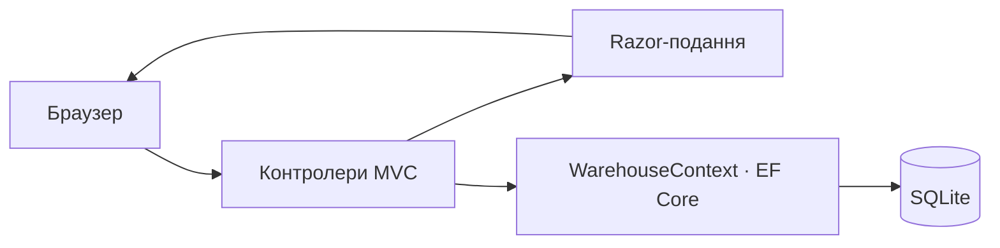

# Object-Oriented Programming

Навчальні матеріали з об'єктно-орієнтованого програмування: UML-моделювання системи «Склад запчастин для авто» та її реалізація як вебзастосунку MVC.

## Матеріали

| Робота | Вміст |
| --- | --- |
| [Лабораторна 1](labs/lab01/) | Звіт з моделювання предметної області. |
| [Лабораторна 2](labs/lab02/) | [Проєкт AutoPartsWarehouse](labs/lab02/AutoPartsWarehouse/), звіти та [контекст роботи](labs/lab02/КОНТЕКСТ_ЛР_2_MVC.md). |
| [UML-діаграми](diagrams/) | [Класів](diagrams/auto_parts_warehouse_classes.drawio), [варіантів використання](diagrams/auto_parts_warehouse_use_case.drawio), [діяльності](diagrams/auto_parts_warehouse_activity.drawio) та [станів](diagrams/auto_parts_warehouse_state.drawio). Файли можна відкрити в diagrams.net. |
| [Документи](docs/) | Титульний аркуш. |

## Склад запчастин

У проєкті лабораторної 2 реалізовано каталог запчастин із пошуком, створенням, редагуванням і видаленням; перегляд і додавання постачальників; створення та приймання замовлень. Видача запчастини перевіряє кількість і підтвердження оплати, зменшує залишок та записує операцію. Фільтр критичних залишків показує позиції з додатним залишком, який не перевищує мінімальний.

Схема нижче відображає структуру застосунку, а не результат окремого запуску:



Стек: C#, .NET 8, ASP.NET Core MVC, Entity Framework Core 8 і SQLite. Моделі та міграції містяться у [проєкті](labs/lab02/AutoPartsWarehouse/); початкове автоматичне наповнення даними в ньому не налаштоване.

## Запуск лабораторної 2

Потрібні .NET 8 SDK та інструмент `dotnet-ef` версії 8.0.22. Наприклад, якщо глобального `dotnet-ef` ще немає, встановіть його командою `dotnet tool install --global dotnet-ef --version 8.0.22`. Для відновлення пакетів та інструмента потрібен доступ до NuGet.

Із кореня репозиторію:

```bash
cd labs/lab02/AutoPartsWarehouse
dotnet restore
dotnet ef database update
dotnet run
```

Відкрийте адресу, яку виведе застосунок; HTTP-профіль налаштовано на `http://localhost:5291`. Міграції потрібно застосувати до першого запуску: `Program.cs` не застосовує їх автоматично. SQLite-файл `AutoPartsWarehouse.db` створюється локально і не входить до репозиторію. Нову базу можна заповнити через форми застосунку.

> У проєкті є файл `dotnet-tools.json`, але він розташований поза стандартним шляхом `.config/dotnet-tools.json`; наведена команда використовує глобально доступний `dotnet-ef`.
